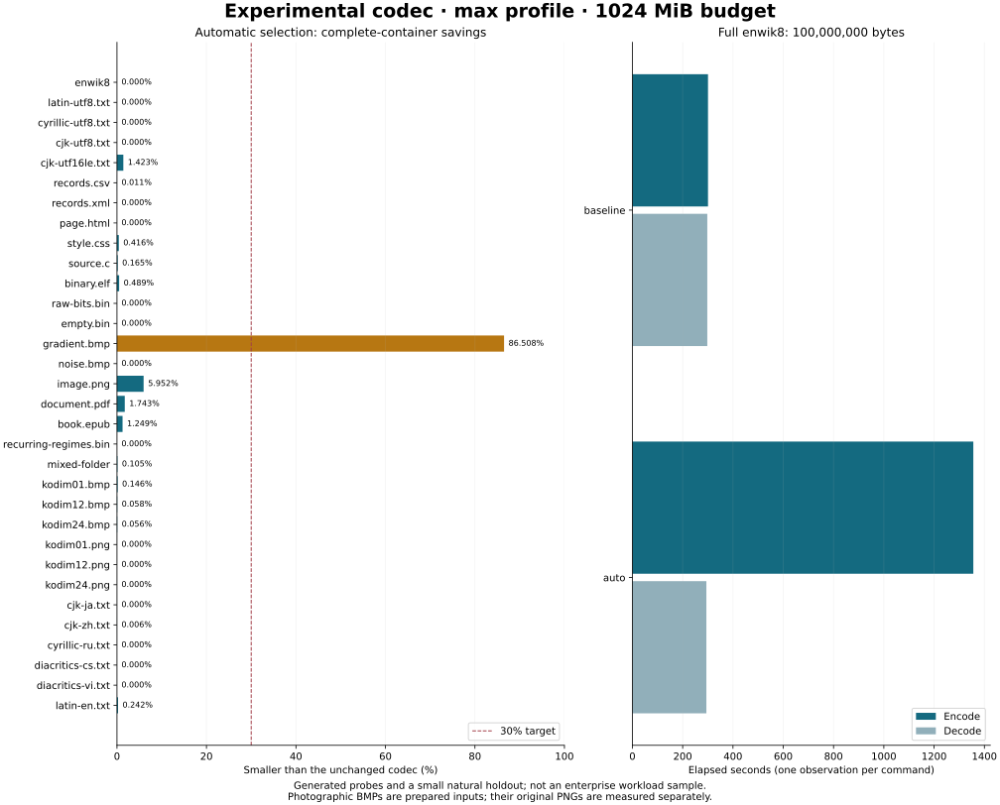

# Current source compression baseline

The user requested the current checkout as the new comparison baseline.
Snapshot `6eb6e41` captures main HEAD `e2ce8ec` plus the uncommitted source,
tests and documentation present at **18:07:24 UTC**. All captured files were
hashed again against the main checkout after copying. The
[source manifest](current-baseline.json) records the complete file list and
hashes. The main working tree and index were not modified.

The snapshot was built with GCC 13.3.0 and the repository's strict C99 flags
(`-O3 -Wall -Wextra -Wpedantic -Werror -DADAPT_THREADS -pthread`). Its frozen
binary SHA-256 is
`bc77916e6fb66535e385d312b1a85cf908fef8fc536ab4dc087d133930ca51b1`.

The comparator is full enwik8: **100,000,000 bytes**, SHA-256
`2b49720ec4d78c3c9fabaee6e4179a5e997302b3a70029f30f2d582218c024a8`.
Normal and max are measured at the default **706,740,224-byte** (674 MiB)
budget; max is also measured at **1,073,741,824 bytes** (1 GiB) to distinguish
predictor improvement from a larger context table. Every comparison uses the
same input, profile and memory budget and counts the entire container. Each
reported successful round trip must pass an independent decoder and exact-byte
comparison. Modes and nanosecond access/modification times are checked before
reading restored content. Encoding verification remains opt-in with `--verify`.

The experiment layers causal calibration, sparse byte contexts, retained
calibration banks and complete-container selection onto this frozen model.
It now composes with `--max`, and a reversible BMP24 candidate is included.
Plain normal, fast and max retain the baseline wire formats 19–24.
The experimental variants use 25–52, as specified in the
[implementation report](causal-byte-implementation.md).

## Confirmed baseline and delivered allocation policy

The user's exact command was:

```sh
/home/admin/github-mirror/_framework/xadapt-c/adpat/c/build/cadapt encode --max /home/admin/xadapt-tests/enwik8 -o /home/admin/xadapt-tests/enwik-10.adpt
```

Its reported **18,831,629 bytes** matches the frozen baseline measurement.
That is the comparator; the earlier 18,520,589-byte figure is superseded by
this confirmed command and output. The user's source file was independently
hashed and matches the full enwik8 fixture above.

The new **`--allocation context`** policy produces **18,564,510 bytes** with the
same default 674 MiB cap: **267,119 bytes smaller (1.41846%)**. The measured
CLI version is `dfe239e`. The policy is a general resource allocation rule:
first grow the context table toward the existing length-derived target, then
grow the recall window with the remaining budget. No input name, language,
corpus dictionary or learned constant selects this allocation (`FMT-2`, `FMT-8`).
Unknown-length streams target the format's table limit; segmented known inputs
use the segment length and account for the requested workers. Fast, normal,
max, explicit adaptive modes, BMP and automatic candidate search accept the
policy. The default `--allocation window` keeps the existing allocation rule.

| Full enwik8, max profile | Memory cap | Context table | Recall window | Complete container |
| --- | ---: | ---: | ---: | ---: |
| Confirmed baseline, window priority | 674 MiB | 256 MiB | 128 MiB | 18,831,629 B |
| New CLI, context priority | 674 MiB | 512 MiB | 64 MiB | 18,564,510 B |
| Separate baseline at a larger budget | 1,024 MiB | 512 MiB | 128 MiB | 18,563,312 B |

Every row also uses a 4 MiB recall index. The context policy spends more of the
allowed memory: measured encode peak RSS rises from **419.39 MiB** to
**643.45 MiB**, within the same cap. Baseline encode took **283.29 s** and the
new CLI **283.52 s** in these single observations. Timings were collected on a
shared host alongside other validation; they do not establish a speed change.

The initial SDK allocation probe produced the same 18,564,510-byte size and
was independently decoded by the original baseline binary, with byte equality
and mode/nanosecond timestamps checked. The subsequent CLI output also passed the original decoder with exact bytes,
permissions, nanosecond timestamps and file type. Its decode took **270.45 s**
in this observation. The source and restored SHA-256 hashes are identical.

To reproduce from this worktree:

```sh
make -C adpat/c
adpat/c/build/cadapt encode --max --allocation context /home/admin/xadapt-tests/enwik8 -o enwik8-context.adpt
adpat/c/build/cadapt decode enwik8-context.adpt -o enwik8-restored
```

Add `--verify` to request verification during the encode operation. Independent
benchmark decoding was performed separately. Allocation changes only existing
header fields and writes ordinary max format 24 for named files; the original
frozen decoder supports it (`FMT-5`, `FMT-6`). No extra model, sidecar or decoder
option is needed. A different allocation can lose on other inputs; the measured
gain is specific to full enwik8 at this budget, without claiming generalization
of the allocation gain to an enterprise corpus.

## Causal predictors on the stronger current model

The predictor experiment used **max at 1 GiB for both sides**, frozen kernel
`86d2691`. It completed **64 encode/decode pairs** across 32 input comparisons:
20 controlled/real fixtures and 12 natural holdout files. `--search-only`
independently decodes the baseline and selected output; all **148 candidate
container sizes** were logged and subsequently checked for complete,
nonduplicated candidate coverage and correct minimum selection. Rejected
full-file candidates were not each decoded separately; all variants have
round-trip unit and CLI coverage.

Full enwik8 results:

| Candidate | Complete container | Difference from matched baseline |
| --- | ---: | ---: |
| Current max | 18,563,312 B | 0 B |
| Rates | 18,565,108 B | +1,796 B |
| Sparse | 18,565,262 B | +1,950 B |
| Retained calibration | 18,565,211 B | +1,899 B |
| Automatic selection | 18,563,312 B | 0 B |

Search selected the unchanged current max stream. Its encode took **1,355.96 s**
versus **300.70 s** for baseline (4.51 times as long); selected-output decode
was **294.21 s**, versus **297.92 s**. Thus these added experts do not improve
full enwik8 on the current model. They remain explicitly selected experiments.

The outcome is consistent with the existing model already capturing most of
what the added calibration learns. The frozen max model has 20 hashed
contexts, four context-conditioned first-layer mixers, a final combiner and
two APM stages. For an ideal fixed-share mixture with switching probability
`alpha = 1/65536`, following one expert throughout `N = 800,000,000` bits incurs
the persistence term:

\[
\frac{N}{8}\log_2\frac{1}{1-\alpha} \approx 2,201.39\text{ bytes}.
\]

The observed regressions are of that scale. This is an interpretation of an
ideal arithmetic term, **not a proved regret bound for the rounded Q24/Q12
implementation**, nor a measurement of how much each expert contributes.
The allocation gain is consistent with reduced competition in the context
table; collision reductions were not directly instrumented.

## Transform and holdout outcomes

The reversible BMP24 color/row residual transform reduced the synthetic
gradient from **16,099 B to 2,172 B (86.51%)**, with sparse calibration selected.
On random BMP bytes, automatic selection retained the untransformed stream.
On all three prepared natural-photo BMPs, the transform lost:

| Prepared BMP | Current max | Best transformed candidate | Selected untransformed adaptive candidate |
| --- | ---: | ---: | ---: |
| Kodak 01 | 465,533 B | 512,406 B | 464,855 B |
| Kodak 12 | 339,412 B | 380,073 B | 339,215 B |
| Kodak 24 | 518,542 B | 519,764 B | 518,250 B |

The small selected savings on these photos come from calibration, not the BMP
transform. Original PNG inputs were tested separately and did not shrink at
all. Prepared BMPs must not be compared to their PNG originals as if decoding
the BMP container restored those original PNG bytes. The photo IDs 01, 12 and
24 were selected before these results; source URLs, file hashes and preparation
versions are included in the result JSON. Preparation used Pillow as research
tooling; the C codec has no Pillow or image-library dependency (`FMT-1`).

Six natural multilingual text holdouts used unchanged algorithm constants:
English saved 0.24218%, Chinese 0.00573%, Czech 0.00042%; Japanese, Russian and
Vietnamese were unchanged. Generated PDF/EPUB/PNG fixtures show some small
savings, but they are tiny controlled probes. There is no JPEG/PDF embedded
stream transform in this implementation.



The [complete measurements](current-baseline-results.json) include every row,
source/tool/binary hashes, commands, timings, memory observations, metadata
checks and candidate sizes. The [implementation report](causal-byte-implementation.md)
defines the predictor and reversible transform in detail.

## Verification, provenance and limits

Every reported selected output and baseline passed byte equality and mode,
access/modification nanosecond and entry-type checks. The broader codec tests
cover the inherited folder metadata implementation (ACLs, xattrs, symbolic and
hard links and sparse extents); filesystem portability rules still apply.
Native and portable C99 builds also produced identical experimental streams
and decoded each other's outputs: 18 predictor/BMP pairs and seven further
allocation-policy pairs, with 50 exact cross-decodes altogether. The final
`make -C adpat/c check` passed: 679 encoder checks, 1,322 decoder checks,
6,891 archive checks, adaptive invariants, 41 CLI tests and the telemetry suite.
Branch coverage was **3,304/3,715 (88.9%)** for the library and
**891/1,276 (69.8%)** for the CLI, above the unchanged 80%/60% floors.
Address/undefined-behavior/leak sanitizer checks, telemetry/plot/probe tests,
Python lint and reproducible-build verification also passed. The result JSON
records the exact tested revisions and the associated evidence.

The original baseline telemetry collector failed to parse the newly present
32-byte filesystem metadata, despite successful encoders. Its failed collection
records are retained verbatim with a correction: the updated parser and
independent full decodes validated the saved containers. Neither failed
collection is presented as a successful original collector run.

**The greater-than-30% enterprise savings objective has not been achieved.**
Thirty percent below the confirmed default max container would require at most
**13,182,140 bytes** on enwik8; the delivered result is 18,564,510 bytes. That
target alone would also not prove enterprise cost savings: the tested set is
small, includes overlapping synthetic content, and contains no representative
storage workload or storage-system overhead/cost model. A byte-weighted sum
of these probes is therefore not reported as enterprise savings.

## Reproducing the matched predictor experiments

Build `6eb6e41` in a separate checkout and retain its binary. Build `86d2691`
for the exact measured predictor kernel; `dfe239e` additionally exposes the
allocation policy and leaves default predictor behavior unchanged. Then run:

```sh
python3 -B bench/adaptive_experiment.py \
  --baseline /path/to/frozen-baseline-cadapt --baseline-revision 6eb6e41 \
  --binary adpat/c/build/cadapt --base-profile max --search-only \
  --memory 1073741824 --output bench/results/repeated-current-max
```

Use `--corpora` with complete holdout files to reproduce supplied-corpus runs.
Use a fresh output directory. The optional plotting command is:

```sh
MPLCONFIGDIR=bench/results/matplotlib python3 -B bench/plot_adaptive_results.py \
  research/current-baseline-results.json --output bench/results/current-results.svg
```

Research sampling uses Python's standard library, Linux `/proc` and GNU time;
the plot additionally uses Matplotlib. None is required to encode or decode.
